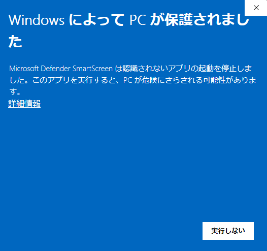
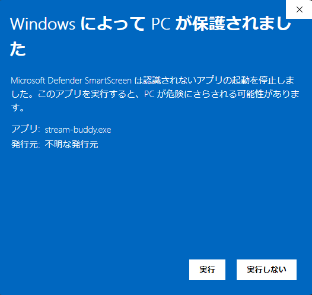

# stream-buddy

1人配信の「無言の時間」に寄り添う、メンダコの相棒オーバーレイ。
OBS Studio のブラウザソースに表示し、あなたの声やキー操作に合わせてリアクションします。

> **v1.2.0 を公開しています。**
> 感想や不具合は [Issue](https://github.com/Tsukimi-0919/stream-buddy/issues) で教えてください（個別のサポートはお約束できません）。
> 実装の状況は [docs/status.md](docs/status.md) を参照してください。

## 特長

- 声に合わせてメンダコが口をパクパク
- たくさん話して盛り上がると、メンダコの動きとセリフも盛り上がる
- しばらく無言が続くと、メンダコが話しかけてくる
- 「死んだ！」「やったー！」などの言葉やホットキーで、メンダコがセリフで反応する
- 死亡・クリアの画面演出
- 盛り上がった時刻と死亡・クリアを Markdown のログに保存（Obsidian 対応）

## 動作環境

- Windows 10 / 11
- OBS Studio
- 軽さの目安：CPU 約 0.4%、メモリ約 220 MB（作者の環境での計測。音声認識モデルの読み込みを含む）

## 導入

### 1. ダウンロード

[Releases](https://github.com/Tsukimi-0919/stream-buddy/releases) から、次の 2 つをダウンロードします（`vX.Y.Z` はバージョン）。

- `stream-buddy-vX.Y.Z-windows-x64.zip`（本体）
- `stream-buddy-vX.Y.Z-windows-x64.zip.sha256`（本物か確かめるためのファイル）

### 2. 本物か確かめる（任意ですが、おすすめします）

2 つのファイルを置いたフォルダで PowerShell を開き、次の 1 行を実行します。`vX.Y.Z` の部分は、ダウンロードしたファイルの名前に合わせて書き換えてください。

```powershell
$name="stream-buddy-vX.Y.Z-windows-x64.zip"; $a=(Get-FileHash $name -Algorithm SHA256).Hash.ToLower(); $b=(Get-Content "$name.sha256" -Raw).Split(" ")[0].Trim(); if($a -eq $b){"一致しました：本物です"}else{"一致しません！ 使わないでください"}
```

- 「一致しました：本物です」と出れば、配布したファイルと同じものです
- 「一致しません！」と出たときは、**そのファイルは使わずに削除し**、Releases からダウンロードし直してください

さらに確かめたい人は、[GitHub CLI](https://cli.github.com/) で次を実行すると、この zip が GitHub Actions でビルドされたもの（ビルド証明）であることを確かめられます。

```powershell
gh attestation verify stream-buddy-vX.Y.Z-windows-x64.zip --repo Tsukimi-0919/stream-buddy
```

### 3. 展開

zip を好きなフォルダに展開します（日本語を含むフォルダでもかまいません）。
`stream-buddy` フォルダができ、その中に `stream-buddy.exe` と `_internal` フォルダがあります。**`_internal` は消さずに、exe と同じフォルダに置いたままにしてください。**

### 4. 音声認識モデル（キーワード検知を使うとき）

「死んだ」「やったー」などのキーワード検知を使うときは、[音声認識モデルの取得](#音声認識モデルの取得キーワード検知を使うとき)の手順でモデルを用意します。
使わないときは飛ばしてかまいません（ホットキーは使えます）。

### 5. 起動と SmartScreen の画面

`stream-buddy.exe` を初めて開くと、次のような青い画面（Microsoft Defender SmartScreen）が出ます。



- この画面が出るのは、stream-buddy が**コード署名をしていない**ためです（費用をかけない方針です。[ADR 0004](docs/adr/0004-exe-packaging.md)）
- 悪いものだという意味ではありませんが、**上の「本物か確かめる」で一致した zip から展開した exe だけ**を実行してください

実行するときは、次の手順で進めます。

1. 「詳細情報」を押す
2. 次の画面で「アプリ：stream-buddy.exe」と表示されていることを確かめる（「発行元：不明な発行元」と出るのは、署名をしていないためです）
3. 「実行」を押す



- **公式の [Releases](https://github.com/Tsukimi-0919/stream-buddy/releases) 以外から手に入れた exe は、実行しないでください**

### 6. OBS の設定

起動すると、コンソールに OBS 用の URL が表示されます。OBS Studio で「ブラウザ」ソースを追加し、その URL を設定します。

- URL にはトークン（合言葉）が含まれます。[注意事項](#注意事項)を必ず読んでください
- メンダコの置き場所は [`&pos=`](#メンダコの置き場所pos) で選べます
- **stream-buddy を先に起動してから OBS を開く**のがおすすめです
  - ページ（メンダコの絵を含む）も stream-buddy が配っているため、OBS を先に開いていると、ページを読み込めないままになります
  - OBS を先に開いていて、メンダコが出ないときは、ブラウザソースを右クリック →「プロパティ」→ 一番下の「現在のページのキャッシュを更新」を押してください

## プライバシー

- 音声は**保存しません**。メモリ上で処理して、すぐに破棄します
- 音声認識は**PC の中だけ**で行い、外部に送信しません
  - キーワード検知のため、音声を最大 1 秒分だけメモリ上で音声認識に渡します。追いつかないときは捨て、ためません
  - 認識した言葉から使うのは「どのキーワードか」だけです。認識した言葉は画面にもファイルにも残しません
- ホットキーは設定したキーだけを受け取り、**他のキー入力は記録しません**
- 利用統計などの送信は一切行いません

## 音声認識モデルの取得（キーワード検知を使うとき）

「死んだ」「やったー」などのキーワード検知には、音声認識モデル（約 100 MB）が必要です。
stream-buddy はモデルを自動ではダウンロードしません。次の手順で手動で用意してください。

1. Vosk の公式サイト <https://alphacephei.com/vosk/models> から `vosk-model-small-ja-0.22` の zip をダウンロードする
2. `stream-buddy.exe` と同じフォルダに `models` フォルダを作り、その中に展開する
   （`models\vosk-model-small-ja-0.22\am` などのフォルダができれば正しい場所です）

   ```text
   stream-buddy\
   ├─ stream-buddy.exe
   ├─ _internal\
   └─ models\
      └─ vosk-model-small-ja-0.22\
         ├─ am\
         ├─ conf\
         ├─ graph\
         ├─ ivector\
         └─ README
   ```

   - 展開のしかたによっては、`models\vosk-model-small-ja-0.22\vosk-model-small-ja-0.22\am` のように**1段深く**なることがあります。そのときは、中の `vosk-model-small-ja-0.22` フォルダの中身を1段上に移してください
3. `stream-buddy --check-model` を実行し、「公式に配布されたものと一致しました」と出ることを確かめる

- 別の場所に置くときは、設定ファイルの `[keywords] model_dir` に絶対パスで指定します
- モデルがないときは、キーワード検知なしで起動します（ホットキーは使えます）
- モデルが公式のものと一致しない（改ざんされているおそれがある）ときは、起動しません。取得し直してください
- キーワード検知を使わないときは、`[keywords] enabled = false` にします

## 確認用の表示（テンションの確かめ方）

メンダコのテンション（calm / normal / high）がどう動いているかを確かめるための表示です。

- `stream-buddy --debug` で起動すると、2 秒ごとにコンソールに次のような行を表示します。テンションが変わったときも 1 行表示します
  （`--demo` と一緒に使えます）

  ```
  [debug] 盛り上がり度 48（話した割合 48 + 補正 0） normal（12.4 秒前に変化） 沈黙: Waiting 0回 イベント: Ready
  [debug] テンション normal → high
  ```

  - 起動したときに 1 回だけ、使っている設定（下の `[tension]`）を `[debug] テンション：窓 15 秒、変化のあと 3 秒は変えない` のように表示します
  - 表示するのは数値と状態の名前だけです。話した内容・セリフ・キーワード・URL のトークンは表示しません
- OBS のブラウザソースの URL の末尾に `&debug=1` を付けると、ページの左上に小さく今のテンションの名前を表示します
  - **この表示は配信画面に映ります。確認が終わったら `&debug=1` を外してください**
  - URL を書き換えるときも、トークンを含む URL を配信に映さないよう注意してください

### テンションの反応の速さ（`[tension]`）

テンションは「直近の何秒かのうち、話していた割合」で決まります。反応が遅い・早すぎると感じたら、設定ファイルで変えられます。

```toml
[tension]
window_seconds = 15   # 5〜30。話していた割合を数える秒数。短いほど早く反応する
hold_seconds = 3      # 1〜10。テンションが変わったあと、次に変えない秒数
```

- 既定（窓 15 秒）では、黙っている状態から話し続けると約 5 秒で normal、約 10 秒で high になります。黙ると約 7.5 秒で normal、そこからさらに約 4.5 秒（黙ってから約 12 秒）で calm に戻ります
- 窓を短くするほど早く反応しますが、ちょっと黙っただけでも下がりやすくなります。ばたばた変わるときは、`window_seconds` か `hold_seconds` を長くしてください
- 書かなければ既定値になります（v1.1.0 までの `config.toml` もそのまま使えます。v1.1.0 までの動きは `window_seconds = 30`、`hold_seconds = 5`）
- 口パクは、この設定に関係なく、話しているかどうかですぐ動きます

## 配信ログ（Markdown・Obsidian 対応）

テンションが High になった時刻と、死亡・クリアの時刻を Markdown のファイルに残せます。アーカイブ動画の見どころ探しに使えます。

1. ログを置くフォルダを作る（Obsidian の Vault の中のフォルダでもかまいません。**stream-buddy はフォルダを作りません**）
2. 設定ファイルに次のように書く

   ```toml
   [log]
   enabled = true
   output_dir = 'D:\Obsidian\配信\ログ'  # 作ったフォルダの絶対パス（' ' で囲むと \ をそのまま書ける）
   include_keyword = false                # true にすると、キーワードで起きた死亡・クリアに言葉を添える
   ```

- 起動するたびに、`stream-buddy-2026-10-27-200012.md` のような名前の新しいファイルを1つ作ります（起動した日時）。同じ名前があれば `-2` などを付け、**既存のファイルは上書きしません**
- できごとが起きるたびにその場で1行書き足すので、途中で落ちてもそこまでの記録は残ります。終了したときに「まとめ」（配信時間と回数）を書き足します
- フォルダがない・ファイルである・書き込めないときは、起動しません

```markdown
| 経過 | 時刻 | できごと |
| --- | --- | --- |
| 00:12:34 | 20:12:46 | テンション High |
| 00:31:40 | 20:31:52 | 死亡（死んだ） |
```

### 記録するもの・しないもの

- 記録するもの：起動からの経過時間、時刻、できごと（テンション High・死亡・クリア）、終了時のまとめ
  - `include_keyword = true` のときだけ、キーワードで起きた死亡・クリアに、検知した言葉（設定に書いたキーワードのどれか。例：死んだ）を添えます。ホットキーのときは添えません
- 記録しないもの：音声、話した内容、セリフ、沈黙ハンターの動き、口パク、URL のトークン、ファイルのパス
  - 音声認識はキーワードとおとりの言葉だけを聞き取るため、話した文章はどこにも残りません

## メンダコの置き場所（`&pos=`）

OBS のブラウザソースの URL の末尾に `&pos=` を付けると、ページの中でメンダコを置く場所を選べます。

| 値 | 置き場所 |
| --- | --- |
| `center`（既定。付けないときと同じ） | 下の中央 |
| `bottom-right` | 右下 |
| `bottom-left` | 左下 |
| `top-right` | 右上 |
| `top-left` | 左上 |

- 上の 5 つ以外の値は無視し、`center` にします
- 死亡・クリアの演出を画面全体に出したいときは、ブラウザソースを配信画面と同じ大きさ（例：1920×1080）にして、`&pos=bottom-right` などでメンダコの位置を決めてください
  - ブラウザソースが小さい（例：400×400）ときは、演出もその範囲の中だけに出ます

## 注意事項

- 起動時に表示される OBS 用の URL には、接続に必要な合言葉（トークン）が含まれています。**URL や、OBS・ブラウザの開発者ツールの画面を配信に映さないでください**
- トークンは保存して使い回すため、URL は作り直すまで有効です。**映ってしまったら `stream-buddy --reset-token` で作り直し**、OBS のブラウザソースの URL を設定し直してください
- ホットキー（既定は F9 / F10）は、stream-buddy が登録している間、**そのキーがほかのアプリ（ゲームなど）に届きません**。
  ゲームの操作と重なるときは、設定ファイルの `[hotkeys]` で `"Ctrl+Shift+F9"` のような組み合わせに変えてください
- ほかのアプリがすでに同じキーを使っていると、そのキーは登録できず、起動時に表示されます（ほかのキーは使えます）

## 既知の制限

- 起動中のタスクバーには、メンダコではなくコンソール（cmd や Windows ターミナル）のアイコンが出ます。stream-buddy がコンソールのアプリのためです（エクスプローラーやショートカットでは、メンダコのアイコンになります）

## 更新するとき

1. 新しい zip を、**古いフォルダとは別の場所**に展開する
2. 古いフォルダから、次のものを新しいフォルダに移す
   - `config.toml`
   - 自分のセリフ集（`[lines] file` で使っていれば）
   - 音声認識モデル（`models` フォルダ。キーワード検知を使っていれば）
3. 新しい `config.example.toml` と `config.toml` を見比べて、増えた項目・なくなった項目を直す
   - 古い設定のままだと、起動時に「知らない項目です」「がありません」と出て起動しません。そのときもこの手順で直してください
4. `stream-buddy.exe --version` で、新しいバージョンになったことを確かめる（例：`stream-buddy 0.1.0 (b12307a, 2026-11-05)`）

- URL のトークンは exe のフォルダではなく `%LOCALAPPDATA%\stream-buddy` に保存しているため、**更新しても OBS の URL は変わりません**
- **v1.0.0 から v1.1.0 に更新するとき**は、設定ファイルとセリフ集の項目は変わっていないので、`config.toml` とセリフ集は**そのまま使えます**（手順 3 の見比べは不要です）
- **v1.1.0 から v1.2.0 に更新するとき**は、`config.toml` は**そのまま使えます**。`[tension]` を書かなければ、テンションの反応は新しい既定値（窓 15 秒・変化のあと 3 秒）になり、v1.1.0 より速く変わります
  - 前と同じ速さにしたいときは、`config.toml` に次のように書いてください

    ```toml
    [tension]
    window_seconds = 30
    hold_seconds = 5
    ```

## 困ったとき

### メンダコが OBS に出ない

- OBS を先に開いていたときは、ブラウザソースを右クリック →「プロパティ」→ 一番下の「現在のページのキャッシュを更新」を押してください（[OBS の設定](#6-obs-の設定)）
- stream-buddy のコンソールに、エラーが出ていないか確かめてください

### 「音声認識モデルが見つかりません」と出る

- メッセージの「探した場所」に、モデルのフォルダ（中に `am`・`conf`・`graph` などがあるフォルダ）を置いてください（[音声認識モデルの取得](#音声認識モデルの取得キーワード検知を使うとき)のフォルダの図）
- 「1段深く展開されているようです」と出たときは、中の `vosk-model-small-ja-0.22` フォルダの中身を1段上に移してください
- 置いたら `stream-buddy --check-model` で確かめられます

### 更新したのに exe のアイコンが古いまま（Python のアイコン）

- Windows が前のアイコンを覚えているためです。exe の中身は新しいものになっています
- PowerShell で次を実行するか、Windows にサインインし直してください

  ```powershell
  ie4uinit.exe -show
  ```

## セキュリティ

設計上の安全対策は [docs/threat-model.md](docs/threat-model.md) にまとめています。
脆弱性の報告方法は [SECURITY.md](SECURITY.md) を参照してください。

## サポートについて

個人で開発・公開しているツールのため、**個別の質問やサポートには対応していません**。
不具合報告は Issue で受け付けますが、対応をお約束するものではありません。

## ライセンス

- ソースコード：[MIT License](LICENSE)
- メンダコの画像などの素材（`src/stream_buddy/overlay/static/img/`）：[CC BY 4.0](https://creativecommons.org/licenses/by/4.0/)、表記は「Tsukimi-0919」。詳しくは [assets/LICENSE](assets/LICENSE) を参照
- 素材の出どころ（AI で作成したことなど）：[CREDITS.md](CREDITS.md) を参照
