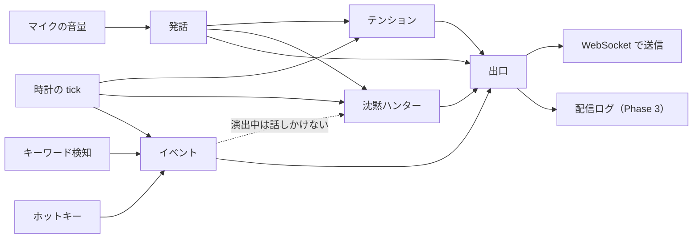
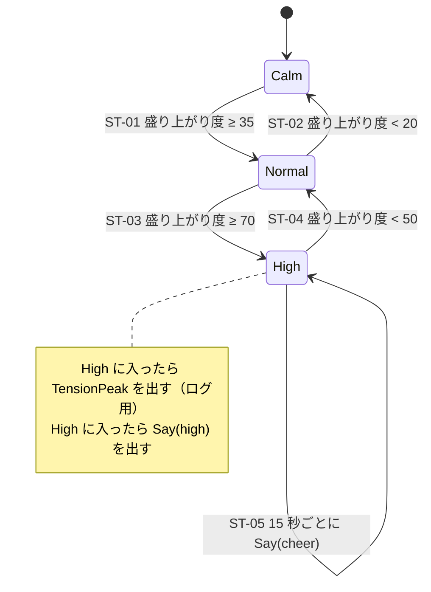
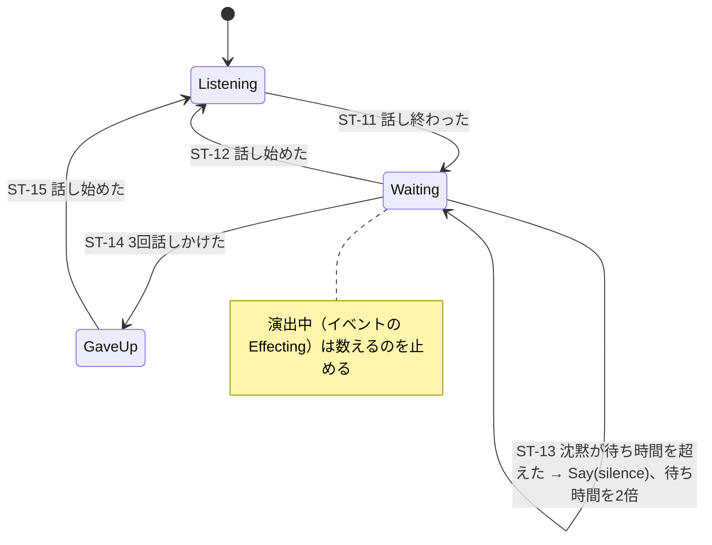
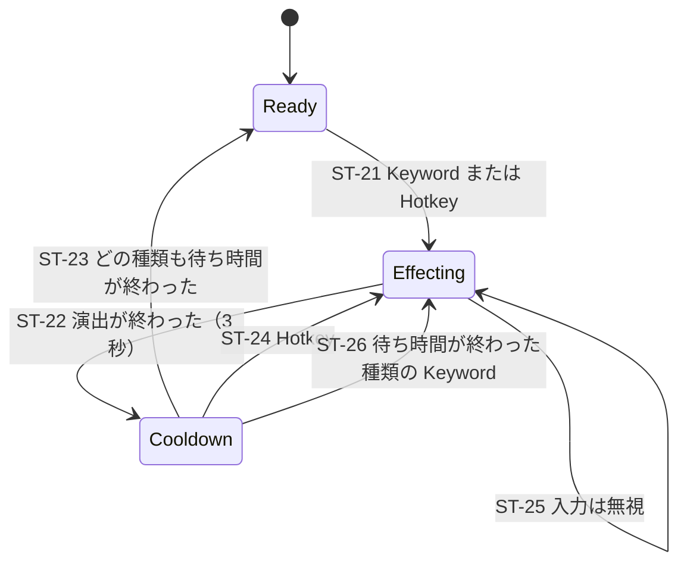

# 状態遷移（Phase 2）

> v1（2026-10-26 確定）。遷移の ID（`ST-xx`）をテスト名に使う。
> 数値は実際の配信で調整する前提。変えたときはこのファイルを先に直す。

## 全体の考え方

メンダコの「心」は、**互いに独立した4つの状態機械**と、それらの出力を整理する**出口（Arbiter）**でできている。

| 状態機械 | 何を持つか | 関連要件 |
| --- | --- | --- |
| 発話（Speech） | 話している／いない（T-05 で実装済み） | FR-02 |
| テンション（Tension） | Calm / Normal / High | FR-04 |
| 沈黙ハンター（Silence） | 黙っている時間と、話しかけた回数 | FR-05 |
| イベント（Event） | 死亡・クリアの演出中かどうか、連続で出さないための待ち時間 | FR-07, FR-08, FR-09 |
| 出口（Arbiter） | 吹き出しの出しすぎを防ぎ、同じセリフを続けない | FR-06 |

### 実装の約束（テストのため）

- 状態機械は**音声・ネットワーク・実時間を直接扱わない**。入力はすべて「イベント」と「今の時刻（ミリ秒）」で渡す
  - 各状態機械は状態を持つクラスにし、`step(input, now_ms) -> 出力のリスト` で1つずつ入力を受け取る
  - 時刻は必ず引数で受け取り、`time` などを import しない。同じ入力と時刻の列を渡せば、いつも同じ出力になる
  - 状態機械どうしは直接呼び合わない。つなぐのは `Brain`（`src/stream_buddy/state/brain.py`）だけ
- 時刻は `time.monotonic()` を外から渡す。テストでは自由な時刻を渡して、何十秒もの流れを一瞬で確かめる
- 外から100 ms ごとに `tick` を入れる（沈黙やテンションの時間経過のため）

### 入力

| 入力 | 送り元 | 中身 |
| --- | --- | --- |
| `SpeechStarted` / `SpeechEnded` | `detect`（T-05） | なし |
| `Keyword(kind)` | キーワード検知（Vosk） | `death` / `clear` |
| `Hotkey(kind)` | ホットキー（`RegisterHotKey`） | `death` / `clear` |
| `Tick` | 100 ms ごと | なし |

### 出力

| 出力 | 行き先 | 対応する WebSocket メッセージ |
| --- | --- | --- |
| `Mouth(speaking)` | ページ | `speech` |
| `TensionChanged(level)` | ページ、ログ | `tension` |
| `Say(situation)` | 出口 → ページ | `say`（セリフは出口が選ぶ） |
| `Effect(kind)` | ページ、ログ | `effect` |
| `TensionPeak` | ログ（Phase 3） | なし |

---

## 1. テンション（FR-04）

**話している割合**から「盛り上がり度」（0〜100）を作り、しきい値で3段階に分ける。
行ったり来たりしないように、**上がるときと下がるときのしきい値を変え**、**変わった直後は5秒動かさない**。

### 盛り上がり度の計算

- 直近 **30 秒**のうち、話していた時間の割合（0〜1）を `ratio` とする
- `盛り上がり度 = ratio × 100`
- **クリア**のイベントが起きたら、盛り上がり度に **+30**（上限 100）。10 秒かけて元の計算に戻る（勝って盛り上がる）
- **死亡**のイベントが起きたら、盛り上がり度に **−30**（下限 0）。10 秒かけて元の計算に戻る（しょんぼりする）
- 加点・減点のあとも「状態を変えない時間（5 秒）」の決まりは守る

| 値 | 決定 | 備考 |
| --- | --- | --- |
| 窓の長さ | 30 秒 | |
| しきい値 | 上がる：35 / 70、下がる：20 / 50 | 実際に配信して調整する前提 |
| 状態を変えない時間 | 5 秒 | |
| クリアの加点 | +30（10 秒で戻る） | |
| 死亡の減点 | −30（10 秒で戻る） | 値は調整する前提 |
| 盛り上げセリフの間隔 | 15 秒 | High の間だけ（2026-10-27 に追加） |

| ID | いまの状態 | 条件 | 次の状態 | 出力 |
| --- | --- | --- | --- | --- |
| ST-01 | Calm | 盛り上がり度 ≥ 35 かつ 前の変化から 5 秒以上 | Normal | `TensionChanged(normal)` |
| ST-02 | Normal | 盛り上がり度 < 20 かつ 前の変化から 5 秒以上 | Calm | `TensionChanged(calm)` |
| ST-03 | Normal | 盛り上がり度 ≥ 70 かつ 前の変化から 5 秒以上 | High | `TensionChanged(high)`、`TensionPeak`、`Say(high)` |
| ST-04 | High | 盛り上がり度 < 50 かつ 前の変化から 5 秒以上 | Normal | `TensionChanged(normal)` |
| ST-05 | High | High に入ってから、または前回の `Say(cheer)` から 15 秒 | High（変わらない） | `Say(cheer)` |

Calm から High へは、必ず Normal を通る（一気に飛ばない）。

- ST-05 は `Tick` のたびに判定する。High を出たら数えるのをやめ、次に High に入ったらそこから数え直す

---

## 2. 沈黙ハンター（FR-05）

黙っている時間を数え、設定の `silence.seconds`（既定 20 秒）を超えたら話しかける。
話しかけ続けるとうるさいので、**間隔を倍々に延ばし、3回で打ち止め**にする。話したら最初に戻る。

| ID | いまの状態 | 条件 | 次の状態 | 出力 |
| --- | --- | --- | --- | --- |
| ST-11 | Listening | `SpeechEnded` | Waiting（待ち時間 = `silence.seconds`、回数 = 0） | なし |
| ST-12 | Waiting | `SpeechStarted` | Listening | なし |
| ST-13 | Waiting | 最後の発話から待ち時間を超えた、かつ回数 < 3 | Waiting（回数 +1、待ち時間 ×2、時計を戻す） | `Say(silence)` |
| ST-14 | Waiting | 回数が 3 になった | GaveUp | なし |
| ST-15 | GaveUp | `SpeechStarted` | Listening | なし |

- 起動直後は **Listening** から始め、**最初に話し終わるまでは数えない**（配信の準備中に話しかけないため）
- 「演出中は数えない」は、`Brain` がイベントの状態機械の状態を見て、沈黙ハンターに `paused` として渡す
  - `paused` は「前の呼び出しから今までが演出中（Effecting）だったか」。演出中だった時間は沈黙に数えない
  - キーワード・ホットキーが来たときは、演出が始まる直前までの時間を数えておく（そのあとが演出中になる）
- 既定の流れ：20 秒 → 40 秒 → 80 秒で話しかけ、あとは黙る（倍々・3回で打ち止め）

---

## 3. イベント（FR-07、FR-08、FR-09）

死亡とクリアの演出を出す。キーワードの誤検知や、「死んだ死んだ！」のような連続で**何度も演出が出ない**よう、待ち時間を設ける。
待ち時間は**種類ごと**に持つ（2026-10-27 に変更）。死亡のすぐあとのクリアのように、違う種類は演出が終われば受け付ける。

| ID | いまの状態 | 条件 | 次の状態 | 出力 |
| --- | --- | --- | --- | --- |
| ST-21 | Ready | `Keyword(k)` または `Hotkey(k)` | Effecting(k) | `Effect(k)`、`Say(k)` |
| ST-22 | Effecting | 演出開始から 3 秒 | Cooldown | なし |
| ST-23 | Cooldown | どの種類も、その種類の前回の演出開始から 5 秒以上 | Ready | なし |
| ST-24 | Cooldown | `Hotkey(k)` | Effecting(k) | `Effect(k)`、`Say(k)` |
| ST-25 | Effecting | `Keyword` または `Hotkey` | Effecting（変わらない） | なし |
| ST-26 | Cooldown | 違う種類の `Keyword(k)`（k の前回の演出開始から 5 秒以上、または初めて） | Effecting(k) | `Effect(k)`、`Say(k)` |

- **ホットキーは人がわざと押すもの**なので、待ち時間（Cooldown）中でも受け付ける
- キーワードは誤検知があり得るので、**同じ種類**は前回の演出開始から 5 秒たつまで受け付けない。違う種類は演出が終われば（3 秒後から）受け付ける
- 演出中（Effecting）は、ホットキーも含めて無視する（演出を途中で切らない）
- Cooldown にいるときは、直前の演出の種類は必ず 5 秒以内なので、ST-26 で受け付けるのは直前と違う種類だけになる

| 値 | 決定 | 備考 |
| --- | --- | --- |
| 演出の長さ | 3 秒 | Phase 3 の演出のデザインで変わる可能性がある |
| キーワードの待ち時間 | 種類ごとに 5 秒（その種類の前回の演出開始から） | 2026-10-27 に「共通で 10 秒」から変更 |
| ホットキーの扱い | Cooldown 中も受け付ける | 連打すると演出が続くが、人の意図なのでそれでよい |

---

## 4. 出口（Arbiter）とセリフ（FR-06）

状態機械が出した `Say(situation)` を、そのまま全部は出さない。**吹き出しが重ならないよう整理**し、セリフを選ぶ。

### 優先順位

`Say` が同時に、または吹き出しの表示中に来たら、優先度の高いほうを出す。

| 優先度 | 場面（situation） | 出し方 |
| --- | --- | --- |
| 1（高） | `death` / `clear` | 表示中の吹き出しがあっても置き換えて出す |
| 2 | `high` / `cheer` | 前の吹き出しから 3 秒以上あいていれば出す |
| 3（低） | `silence` | 前の吹き出しから 3 秒以上あいていれば出す |

最短間隔は 3 秒（2026-10-27 に 5 秒から変更）。実際に使って変える可能性があるので、コード内で1か所の定数にまとめる。

- `Mouth`・`TensionChanged`・`Effect` はそのまま送る（間引かない）

### セリフの選び方

- セリフは場面ごと・テンションごとに **TOML ファイル**で持つ（コードを触らずに差し替えられる：NFR-04）
- ファイルの形（既定は `src/stream_buddy/data/lines.toml`）：表とキーごとにセリフの配列を書く

  | `Say` の場面 | ファイルの場所 |
  | --- | --- |
  | `silence` | `[silence]` の `calm` / `normal` / `high`（そのときのテンションで選ぶ） |
  | `high` | `[tension]` の `high` |
  | `cheer` | `[tension]` の `cheer` |
  | `death` / `clear` | `[event]` の `death` / `clear` |
- 候補から**ランダムに選ぶ**が、**直前に出したものは選ばない**（候補が1つなら同じでもよい）
- すべてのセリフは**1〜80 文字**（WebSocket の `say` の上限）。読み込み時に検証し、違反があれば起動しない
- テストのため、乱数は外から渡せるようにする

---

## 解釈の補足（T-08 の実装で決めたこと）

1. **沈黙の「超えた」**：待ち時間ちょうどでは話しかけず、それより長くなったら話しかける。
   tick が 100 ms ごとなので、既定では 20.1 秒、60.2 秒、140.3 秒で話しかける（「20 → 40 → 80 秒」は、それぞれ話しかけた時点から数え直した間隔）
2. **ST-14 の時期**：3 回目に話しかけたその場で GaveUp にする
3. **出口で捨てられた `Say(silence)`**：捨てられても、沈黙ハンターの回数は増える（後で出し直さない）
4. **起動から 30 秒未満の盛り上がり度**：窓はいつも 30 秒として計算する（起動前は黙っていた扱い）
5. **補正の重なり**：10 秒以内にクリアと死亡が続くなど、補正が重なったときは足し合わせる。
   それぞれが 10 秒かけて 0 に戻り、合計を 0〜100 に収める
6. **イベントの時間による遷移**：tick だけでなく、どの入力のときにも先に判定する。
   そのため、同じ種類の前回の演出開始からちょうど 5 秒に来たキーワードは受け付ける（T-13 で 10 秒から 5 秒に変更）
7. **同じ時刻の複数の `Say`**：1 回の `Brain.step` の出力の中で、という意味。
   優先度の最も高いものだけを残し、残したものにも最短間隔（3 秒）の決まりを当てる
8. **クリアで High になったときの `Say(high)`**：直前の `Say(clear)` から 3 秒たっていないため出ない。**これは意図した動き**
   （クリアの吹き出しを優先し、続けて吹き出しを出さない）

## 解釈の補足（T-13 の実装で決めたこと）

9. **出口で捨てられた `Say(cheer)`**：捨てられても、言ったものとして 15 秒を数え直す（後で出し直さない。補足 3 と同じ考え方）
10. **ST-04 と ST-05 が同じ tick に重なったとき**：ST-04 を優先し、High を出るので `Say(cheer)` は出さない

## 決定の記録（2026-10-26）

| 項目 | 決定 |
| --- | --- |
| テンションの窓・しきい値・変化しない時間 | 提案どおり（30 秒、35 / 70 と 20 / 50、5 秒） |
| イベントでのテンション変化 | クリアで +30、死亡で −30。どちらも 10 秒で戻る |
| 沈黙ハンターの開始 | 起動直後からは数えない（最初の発話のあとから） |
| 沈黙ハンターの間隔 | 倍々・3 回で打ち止め |
| 演出の長さ・キーワードの待ち時間 | 3 秒・種類ごとに 5 秒（2026-10-27 に「共通で 10 秒」から変更。OBS で 2 回目以降のキーワードが反応しないことがあったため） |
| ホットキー | Cooldown 中も受け付ける |
| 吹き出しの最短間隔 | 3 秒（2026-10-27 に変更） |
| High の間の盛り上げセリフ（ST-05） | 15 秒ごと（2026-10-27 に追加） |

## このあとのタスク分け

| ID | タスク | 関連 |
| --- | --- | --- |
| T-08 | 状態機械（テンション・沈黙・イベント・出口）を純粋な関数で実装し、`ST-xx` ごとにテスト | FR-04〜FR-06 |
| T-09 | セリフファイルの読み込みと検証、既定のセリフ集 | FR-06, NFR-04 |
| T-10 | Vosk のキーワード検知を本体に組み込む（既定キーワードとおとりの変更を含む） | FR-07, SR-07 |
| T-11 | ホットキー（`RegisterHotKey`） | FR-08, SR-05 |
| T-12 | 組み立て：入力 → 状態機械 → WebSocket。`--demo` を状態機械経由に置き換え | Phase 2 のゲート |
